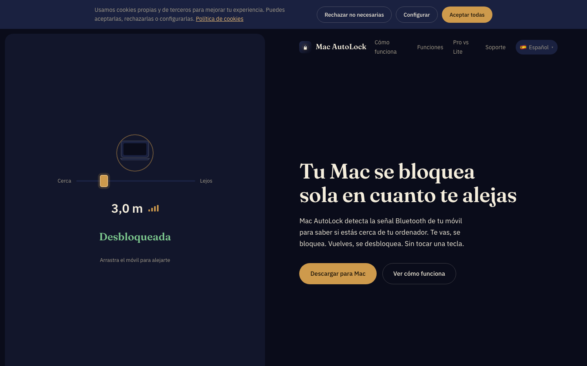

  

<h1 align="center">Mac AutoLock</h1>

Your Mac locks itself the moment you walk away. Bluetooth proximity detection — you leave, it locks; you come back, it unlocks. No keys touched.

  
  
  
  

🌍 <a href="README.es.md">🇪🇸 Español</a> · <strong>🇬🇧 English</strong> · <a href="README.de.md">🇩🇪 Deutsch</a> · <a href="README.fr.md">🇫🇷 Français</a> · <a href="README.it.md">🇮🇹 Italiano</a> · <a href="README.pt.md">🇵🇹 Português</a>

> **This repository publishes official binary releases only** — the source code is private. Signed downloads, checksums and auto-update feeds.

## Download

| | |
|---|---|
|  **Pro (DMG)** | [Download the latest DMG](https://github.com/mavksoft/macautolock-releases/releases/latest) — full control, no App Store limits |
|  **Lite** | [Mac AutoLock Lite on the Mac App Store](https://apps.apple.com/app/id6812660335) |
|  **Website** | [www.macautolock.com](https://www.macautolock.com) |

## What it is

Mac AutoLock watches the Bluetooth signal of your phone. Step away from your desk and the signal fades → your session locks. Come back → it unlocks for you. Your phone is the key; nothing else to carry, nothing to remember.

## Features

- **Real session lock & unlock** — automatic unlock with Keychain (Pro edition).
- **Intrusion alerts** — silent photo of whoever touches your Mac while you're away (Pro).
- **Trusted networks** — never locks at home or at the office (Wi-Fi whitelist).
- **iOS companion app** — lock and unlock your Mac remotely from your iPhone.
- **BLE proximity engine** — adjustable distance and timing thresholds.
- **Unlimited Macs & phones** — one plan covers all your machines (Pro).
- **App Store Lite edition** — the same proximity engine inside Apple's sandbox.

## How to use it

1. Download the DMG, drag Mac AutoLock to Applications and open it.
2. Pair your iPhone/Android over Bluetooth following the wizard (2 minutes).
3. Tune the lock distance with the slider — the app shows live signal strength.
4. Walk away: once the signal drops enough, the session locks itself.
5. Optional: mark your Wi-Fi as a trusted network so it never locks at home.

## Editions & pricing

|  | Lite (App Store) | Pro (DMG) |
|---|---|---|
| **Proximity engine** | ✓ | ✓ |
| **Session lock** | Standard macOS | ✓ + auto-unlock |
| **Intrusion photo** | — | ✓ |
| **Trusted networks** | — | ✓ |
| **Sandboxed** | ✓ | — |
| **Updates** | App Store | Automatic Sparkle |

## Requirements

Recent macOS with Bluetooth LE · iPhone or Android with BLE for proximity · Signed & notarized by Apple (DMG).

## What's in this repository

- `MacAutoLock.dmg` — signed + notarized Pro installer
- `MacAutoLock-<version>.zip` — Sparkle update archive (EdDSA) used by the in-app auto-updater
- `*.delta` — Sparkle delta updates between versions

[Latest release](https://github.com/mavksoft/macautolock-releases/releases/latest)

## FAQ

**Why two editions?**  
The App Store sandbox doesn't allow camera access or true auto-unlock — that's why the Pro DMG (outside the sandbox) has every feature while Lite offers standard locking.

**Does it drain my phone's battery?**  
No — it uses Bluetooth Low Energy. The extra drain on the phone is negligible.

**What if Bluetooth turns off?**  
The app detects the signal loss and applies the configured policy (graceful lock, notification, etc.).

## Support

- Website: [www.macautolock.com](https://www.macautolock.com)
- Email: [support@it-systems.es](mailto:support@it-systems.es)

---

Mac AutoLock · © MavkSoft / IT-Systems

