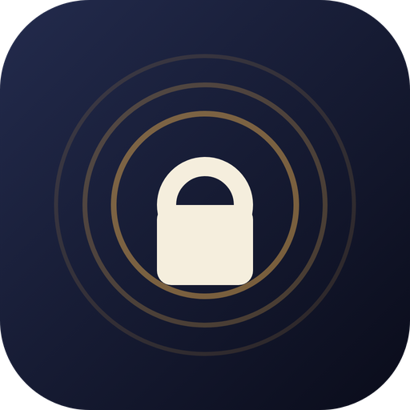

  

<h1 align="center">Mac AutoLock</h1>

O seu Mac bloqueia-se sozinho no momento em que se afasta. Deteção de proximidade por Bluetooth — afasta-se, bloqueia; volta, desbloqueia. Sem tocar numa tecla.

  
  
  
  

🌍 <a href="README.es.md">🇪🇸 Español</a> · <a href="README.md">🇬🇧 English</a> · <a href="README.de.md">🇩🇪 Deutsch</a> · <a href="README.fr.md">🇫🇷 Français</a> · <a href="README.it.md">🇮🇹 Italiano</a> · <strong>🇵🇹 Português</strong>

> **Este repositório publica apenas releases binários oficiais** — o código-fonte é privado. Downloads assinados, checksums e feeds de atualização automática.

## Transferir

| | |
|---|---|
| 📥 **Pro (DMG)** | [Descarregar o último DMG](https://github.com/mavksoft/macautolock-releases/releases/latest) — controlo total, sem limites da App Store |
| 🍎 **Lite** | [Mac AutoLock Lite na Mac App Store](https://apps.apple.com/app/id6812660335) |
| 🌍 **Site oficial** | [www.macautolock.com](https://www.macautolock.com) |

## O que é

O Mac AutoLock vigia o sinal Bluetooth do seu telemóvel. Ao afastar-se da secretária, o sinal enfraquece e a sessão bloqueia; ao voltar, desbloqueia por si. O telemóvel é a chave — mais nada para levar, nada para memorizar.

## Funcionalidades

- **Bloqueio e desbloqueio reais** — desbloqueio automático da sessão com o Keychain (Pro).
- **Alertas de intrusão** — foto silenciosa de quem toca no seu Mac na sua ausência (Pro).
- **Redes de confiança** — nunca bloqueia em casa nem no escritório (lista branca de Wi-Fi).
- **App iOS companheira** — bloqueie e desbloqueie o Mac à distância a partir do iPhone.
- **Motor de proximidade BLE** — limiares de distância e temporização ajustáveis.
- **Macs e telemóveis ilimitados** — um só plano cobre todos os seus equipamentos (Pro).
- **Edição Lite na App Store** — o mesmo motor de proximidade dentro da sandbox da Apple.

## Como usar

1. Descarregue o DMG, arraste o Mac AutoLock para Aplicações e abra-o.
2. Emparelhe o seu iPhone/Android por Bluetooth com o assistente (2 minutos).
3. Ajuste a distância de bloqueio com o cursor — a app mostra o sinal em direto.
4. Afaste-se: quando o sinal cai o suficiente, a sessão bloqueia sozinha.
5. Opcional: marque o seu Wi-Fi como rede de confiança para nunca bloquear em casa.

## Edições e preços

|  | Lite (App Store) | Pro (DMG) |
|---|---|---|
| **Motor de proximidade** | ✓ | ✓ |
| **Bloqueio de sessão** | Padrão macOS | ✓ + desbloqueio automático |
| **Foto de intrusão** | — | ✓ |
| **Redes de confiança** | — | ✓ |
| **Sandbox** | ✓ | — |
| **Atualizações** | App Store | Sparkle automático |

## Requisitos

macOS recente com Bluetooth LE · iPhone ou Android com BLE para proximidade · Assinado e notarizado pela Apple (DMG).

## O que contém este repositório

- `MacAutoLock.dmg` — instalador Pro assinado + notarizado
- `MacAutoLock-<versão>.zip` — arquivo de atualização Sparkle (EdDSA) para o auto-updater
- `*.delta` — atualizações delta Sparkle entre versões

[Versão mais recente](https://github.com/mavksoft/macautolock-releases/releases/latest)

## Perguntas frequentes

**Porque existem duas edições?**  
A sandbox da App Store não permite acesso à câmara nem desbloqueio automático real — o DMG Pro (fora da sandbox) tem todas as funções, o Lite o bloqueio padrão.

**Gasta a bateria do telemóvel?**  
Não — usa Bluetooth Low Energy. O consumo extra é praticamente nulo.

**E se o Bluetooth desligar?**  
A app deteta a perda de sinal e aplica a política configurada (bloqueio com tolerância, notificação…).

## Suporte

- Site: [www.macautolock.com](https://www.macautolock.com)
- Email: [support@it-systems.es](mailto:support@it-systems.es)

---

Mac AutoLock · © MavkSoft / IT-Systems

